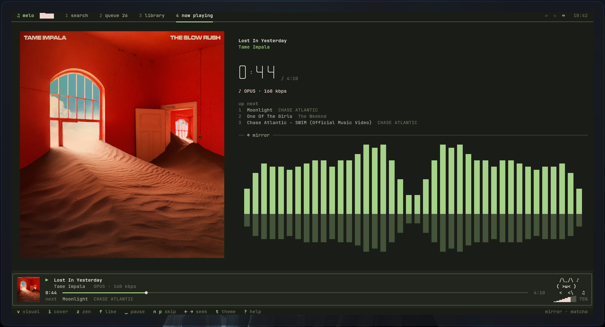
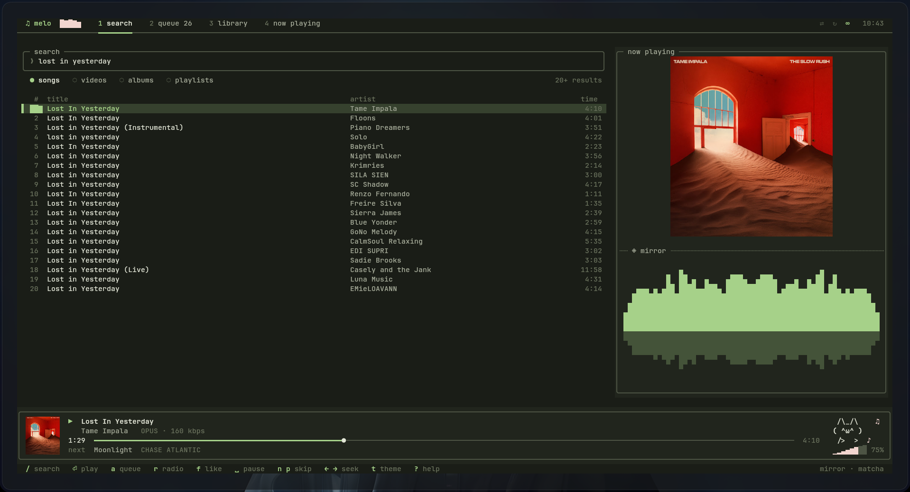

# ♫ Melo

```
███╗   ███╗███████╗██╗      ██████╗
████╗ ████║██╔════╝██║     ██╔═══██╗
██╔████╔██║█████╗  ██║     ██║   ██║
██║╚██╔╝██║██╔══╝  ██║     ██║   ██║
██║ ╚═╝ ██║███████╗███████╗╚██████╔╝
╚═╝     ╚═╝╚══════╝╚══════╝ ╚═════╝
```

Music from YouTube Music, streamed and visualized entirely in your terminal. Linux only.





- **Search YouTube Music**: songs, videos, albums and playlists, with infinite scroll. You can also paste a YouTube or YouTube Music link.
- **Queue, radio and autoplay**: `r` builds a radio from any song. When the queue runs out, autoplay keeps adding similar songs.
- **Real visualizers**: an FFT of the audio you're actually hearing, in seven styles: bars, LED matrix, mirror, ASCII rain, waveform, radial and stereo scope.
- **Cover art**: kitty, ghostty, WezTerm and Konsole show the real, sharp cover. Other terminals draw it as coloured ASCII characters or half-block pixels; press `i` to switch styles. Tracks without artwork get a cassette tape with spinning reels.
- **A cat**: Melo's mascot lives in the player bar. It dances while music plays, naps when paused, thinks while loading, cries on errors and gets heart eyes when you like a song.
- **Seven flat themes**: rose (default), mocha, matcha, peach, nord, neon and mono. Each uses one solid accent colour, with no gradients.
- **Big clock**: box-drawn digits on the Now Playing screen, plus a zen mode that makes the visualizer fullscreen.
- **Library**: liked songs and play history, saved to plain TSV files.
- **Mouse support**: click to seek, select, switch tabs, set the volume or change the visualizer. Scroll lists with the wheel.
- **Local files**: `melo ~/Music/Album/` queues and plays a folder, including embedded cover art.
- **Desktop mixer integration**: Melo shows up as its own "Melo" stream in pavucontrol and other PipeWire/Pulse mixers.

## Requirements

- Linux with a truecolor terminal, such as kitty, alacritty, foot, wezterm, GNOME Terminal or Konsole
- Java 21 or newer
- `ffmpeg`
- `pacat` (PipeWire/Pulse) or `pw-cat` for audio output. Melo falls back to ALSA through javax.sound if neither is found.
- Optional: `yt-dlp`, used as a fallback when YouTube rejects a stream

## Install

1. Install the dependencies:

   ```sh
   sudo pacman -S jdk-openjdk ffmpeg              # Arch
   sudo apt install openjdk-21-jdk ffmpeg         # Debian / Ubuntu
   sudo dnf install java-21-openjdk-devel ffmpeg  # Fedora
   ```

2. Clone and install. This needs no root and no Gradle:

   ```sh
   git clone https://github.com/jay6869/melo.git
   cd melo
   ./install.sh
   ```

   `install.sh` downloads about 3.6 MB of libraries, checks them against pinned SHA-256 checksums, compiles with `javac`, and installs to `~/.local/bin/melo`. It resumes interrupted downloads, so it's safe to rerun on a slow connection.

3. Run `melo`. If your shell can't find it, add `~/.local/bin` to your PATH:

   ```sh
   echo 'export PATH="$HOME/.local/bin:$PATH"' >> ~/.bashrc   # bash
   fish_add_path ~/.local/bin                                 # fish
   ```

To update, run `git pull && ./install.sh`. To uninstall, run `rm -rf ~/.local/bin/melo ~/.local/share/melo ~/.config/melo ~/.cache/melo`.

For development, `./gradlew run` also works.

## Keys

| key | action |
| --- | --- |
| `/` | search. `tab` switches between songs, videos, albums and playlists |
| `enter` | play the selection, or open an album or playlist |
| `a` / `A` | add to queue / play next |
| `r` | start a radio from a song |
| `f` | like or unlike |
| `space` | play / pause |
| `n` / `p` | next / previous |
| `←` `→` or `h` `l` | seek 5 s. `shift` or `,` `.` seeks 30 s |
| `+` `-` / `m` | volume / mute |
| `s` / `R` / `x` | shuffle / repeat (off, all, one) / autoplay |
| `1` `2` `3` `4`, `tab` | search · queue · library · now playing |
| `d`, `J` `K`, `C` | remove from queue, move it, clear the queue |
| `v` / `t` / `z` | visualizer / theme / zen mode |
| `i` | cover art: sharp (kitty, ghostty, WezTerm, Konsole) · ASCII · pixels |
| `?` | every key binding |
| `q` | quit |

## Options

```
melo [--theme NAME] [--audio auto|pulse|pipewire|java] [--transparent] [files…]
```

Settings are stored in `~/.config/melo`, the library in `~/.local/share/melo`, and the log in `~/.cache/melo/melo.log`.

## How it works

```
NewPipeExtractor ──► stream URL ──► ffmpeg (decode → s16le PCM) ──► Player ──► pacat / pw-cat
   (search, albums,                                               │
    radio, metadata)                                              └► sample ring ──► FFT ──► visualizers
```

- `source/`: YouTube Music through [NewPipeExtractor](https://github.com/TeamNewPipe/NewPipeExtractor). It uses a `java.net.http` downloader and needs no API keys.
- `audio/`: each play or seek starts its own ffmpeg process and audio sink. Writes to the sink are paced against a wall clock, so the visualizer stays in sync with what you hear.
- `term/`: raw-mode TTY handling and a key/mouse decoder. The screen is double-buffered and only changed cells are redrawn, inside synchronized-update blocks so frames never tear. Braille dots give a 2×4 sub-cell canvas.
- `ui/`: themes, visualizers, album-art rendering, the logo and the big digits.

For layout work without a TTY, `melo --snapshot 120x40` renders every screen as plain text. `melo --selftest some.flac` runs the audio path silently.

## License

Melo is free software under the [GNU GPL v3](LICENSE). It builds on [NewPipeExtractor](https://github.com/TeamNewPipe/NewPipeExtractor), which is also GPL-3.0.

Melo is an independent project. It isn't affiliated with or endorsed by YouTube or Google.
